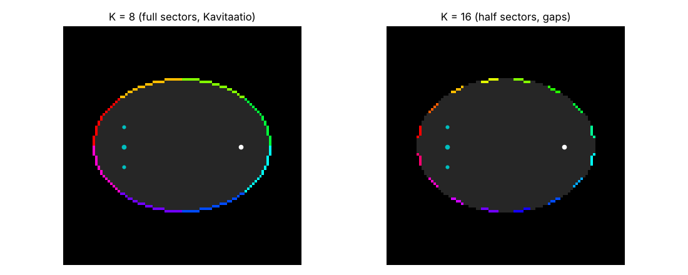
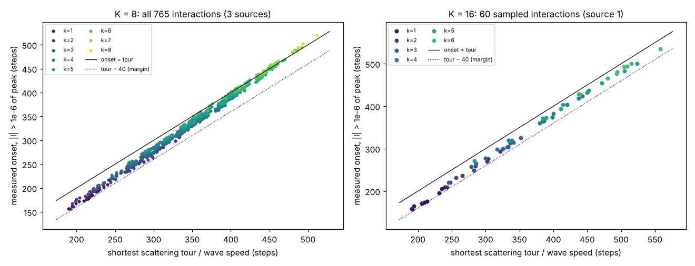
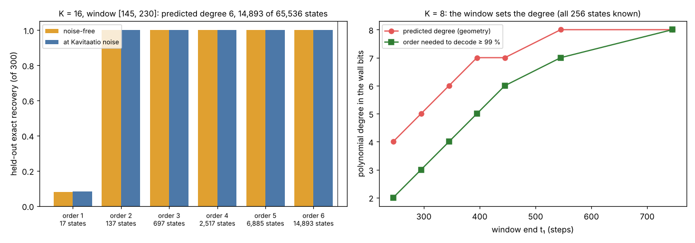
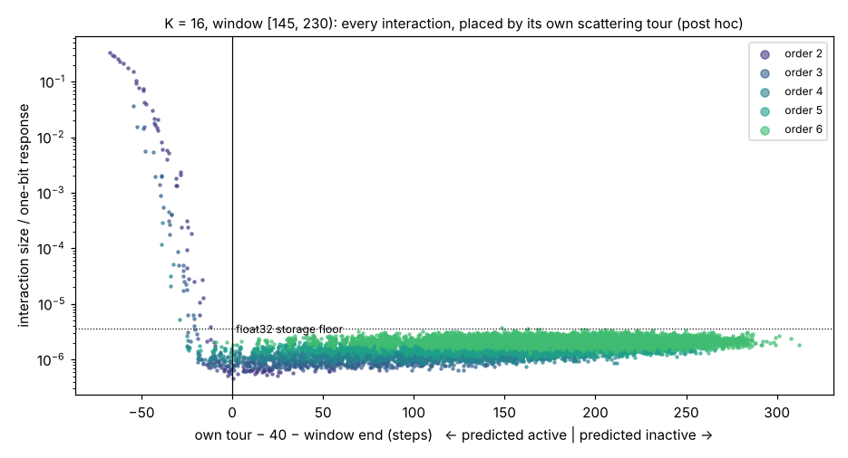
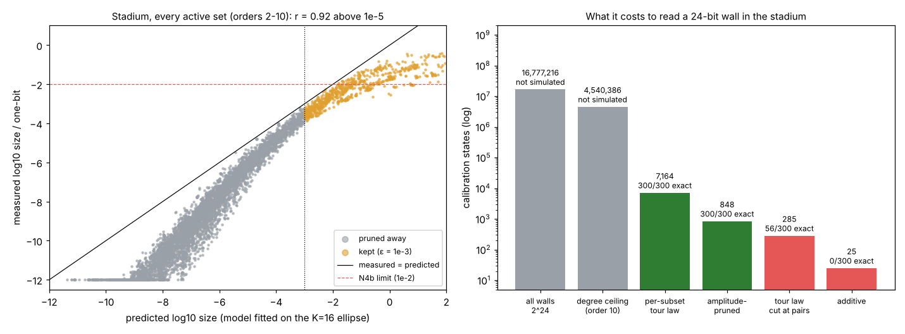

# Wall Memory Law

**The listening window sets the polynomial degree of a writable-wall cavity memory,
and the scattering geometry predicts which interactions it contains.** In a chaotic
stadium with 24 writable patches (16,777,216 walls), the law picked 848 calibration
states out of 16.7 million in advance, and those 848 read every held-out 24-bit wall
exactly, also at noise. Two pre-registrations; the second passed all five tests.

Sol's [Kavitaatio](https://github.com/anttiluode/Kavitaatio) built an elliptical
cavity whose wall patches can be *written* (a Robin spring) and *read* by a ping from
one focus to the other. Several written patches interact: the echo is not the sum of
their single echoes. With 8 patches, Sol found additive and pairwise models fail on
held-out multi-patch walls, while a full 256-state table decodes everything. That full
table costs 2^K, and the question this repo answers is what the calibration really
costs.

Live page: **[anttiluode.github.io/WallMemoryLaw](https://anttiluode.github.io/WallMemoryLaw/)**.
Write patches by clicking the wall, ping, and measure any written set's interaction by
inclusion–exclusion (2^k simulations in your browser). The page draws its shortest
scattering tour and marks the predicted onset on the trace.



## The law

A written patch is a local scatterer. In the multiple-scattering series, the
interaction of a set S of patches (its Möbius / inclusion–exclusion coefficient)
collects only the paths that scatter off **every** patch in S. So it cannot reach the
receiver before

    tour(S) = min over orders and wall points of |source − p₁| + |p₁ − p₂| + … + |p_k − receiver|

divided by the wave speed. The tour uses straight chords, since the cavity is convex
and extra reflections only add length. A listening window that ends at t₁ sees only
the interactions whose tours fit inside it. The echo is then a polynomial in the wall
bits whose terms are known in advance, from geometry alone.

Prior art: order-of-scattering expansions, the Born / Neumann series, and the
room-acoustics image-source method, in which reflection order grows with time
(Allen & Berkley 1979). Causal truncation of the scattering series is known physics.
What is new here is using it as a **calibration law for a writable-wall memory**:
which wall states you must measure to read every wall state.

## Results

**Onsets follow tours.** The onset is where an interaction first exceeds 1e-6 of its
peak.

- K = 8, all 765 interactions over 3 sources: r = **0.998**.
- K = 16, 60 sampled interactions: r = **0.999**.
- Onsets run up to 38 steps early. This is not exact zero: the Gaussian pulse's tails
  and the discrete stencil leak exponentially small precursors (1e-12 of peak about 54
  steps early). The margin was frozen at 40 steps from K = 8.



**K = 16, pre-registered** ([PREREG.md](PREREG.md), pushed as `cee4b48` before any
K = 16 state was simulated). 16 patches with gaps, window [145, 230), 3 sources, 300
held-out walls with ≥ 7 written patches, exhaustive decoding over all 65,536 states.

| | claim | result |
|---|---|---|
| P1 | calibrating to the geometric degree (6, i.e. 14,893 states) is exact | **PASS**: 300/300, model error 5e-6 |
| P2 | onsets follow tours, none more than 40 steps early | **PASS**: r = 0.999, max 37.7 early |
| P3 | the order actually needed is 4–6 | **FAIL (low)**: order **2** (137 states) already decodes 300/300, also at Kavitaatio's noise level |



So the order-level law is a **safe ceiling**, and at K = 8 it was 1–2 orders loose.
At K = 16 in a short window it is 4 orders loose: it paid for 14,893 states when 137
were enough.

**Why, and the sharper law (post hoc, not pre-registered).** The order-level law
treats every k-patch set alike. But the tour belongs to each set: inside a short window
most pairs simply do not interact, because their tours have not arrived. Placing every
measured K = 16 interaction by its *own* tour gives a clean wall:



- Every interaction whose own tour misses the window (14,674 of them) sits on the
  float32 storage floor, ≤ 4e-6 of a one-bit response.
- Every real interaction lies inside the predicted-active set: pairs up to 0.33,
  triples up to 0.036, and a few 4-sets up to 3e-4.
- Calibrating only the predicted-active sets and their sub-states: **219 states**
  (0.33 % of 65,536). Result: 300/300 exact, also at noise, model error 3e-7.
- The same check at K = 8 holds in every window (t₁ = 245 … 545): no predicted-inactive
  interaction exceeds 8e-7.

This per-subset law is the one to pre-register next. It is post hoc here, chosen after
seeing P3 fail.

## Second pre-registered test: a chaotic stadium, 24 patches

[PREREG_STADIUM.md](PREREG_STADIUM.md), pushed as `9a1ce6b` before any stadium wall
was simulated. It tests the two rules found post hoc above in a geometry where they
were not fitted:

- a Bunimovich stadium, which has no foci and chaotic rays;
- source and receiver off every symmetry axis;
- 24 patches with gaps;
- a window set by a rule, [155, 283);
- 300 held-out walls with random bits (about 12 written patches each).

2^24 walls is about six days of simulation, so the law is the only way in. Decoding
uses descent over 1- and 2-bit flips. A miss would be labelled a search failure or a
model failure; there were none.

| | claim | result |
|---|---|---|
| N1 | the per-subset tour law (**7,164** states, 0.043 %) is exact | **PASS**: 300/300, 300/300 at noise, model error 5e-10 |
| N2 | the amplitude-pruned model (**848** states, 0.005 %) is exact | **PASS**: 300/300, 300/300 at noise, model error 9e-5 |
| N3 | tour-inactive sets are empty | **PASS**: all 16 inactive pairs and 24 boundary triples, measured directly, ≤ **2e-8** of a one-bit response (rule ≤ 1e-5) |
| N4a | the amplitude model transfers to the new shape | **PASS**: r = 0.92 over 1,380 active sets |
| N4b | pruning is safe | **PASS**: 6,316 sets pruned away, largest measures 6e-4 (rule < 1e-2) |

The memory is strongly non-additive here, so this is not an easy pass. Cutting the tour
law at pairs (285 states) decodes 56/300, and the additive model (25 states) decodes
0/300. The order-level ceiling would have needed 4,540,386 states.



Post hoc observation: in the stadium, the amplitude model fitted on the ellipse
behaved as an **upper envelope**. Only 1 of 7,139 active sets measured above its
prediction, and that one by 0.00 dex; the median sits 2 decades below
(`results/stadium_envelope_posthoc.json`). That is why pruning was conservative rather
than lucky. Whether it is an envelope in general, and not just for this pair of
geometries, is untested.

## What it means

- Kavitaatio's memory is strongly non-additive, but the non-additivity is
  **scheduled**. Which walls can talk to each other, and when, is fixed by the cavity's
  shape and the wave speed.
- For a window of length t₁, the calibration cost is the number of patch sets whose
  scattering tour fits in t₁. It is computable before any measurement: 7,164 of 16.7
  million in the stadium. With an amplitude model on top it is 848.
- In Williams' TIME ⊆ SPACE construction (the TheComb thread), *bounded degree* is what
  makes reuse cheap. Here, finite wave speed supplies bounded degree for free. This is
  an analogy of structure, not a complexity result.
- Inside the active set, interactions grow about a decade per 10 steps of lead time and
  shrink about 0.75 decade per extra patch. That amplitude model, fitted on one
  geometry, predicted what another geometry needs (stadium N2, N4). This was the
  honest fix for P3.

## Ledger

**Verified**
- The batched simulator reproduces Kavitaatio's `simulate()` to 3e-15. The JS page
  reproduces the Python simulator to 4e-15, and its tours match exactly
- Onset vs tour: r = 0.998 (K = 8, n = 765) and 0.999 (K = 16, n = 60); max early 37.7
  steps, inside the 40-step margin
- K = 16: geometric ceiling exact (P1), onsets follow tours (P2), pre-registered
- Per-subset law, post hoc, at K = 8 and K = 16: no predicted-inactive interaction above
  the float32 floor; 219-state calibration decodes all 300 held-out 16-bit walls

- Stadium, K = 24, pre-registered: per-subset tour law exact (N1), amplitude-pruned
  848-state model exact (N2), tour-inactive sets ≤ 2e-8 (N3), amplitude model transfers
  (N4a, r = 0.92), pruning safe (N4b)

**Failed**
- P3: the needed order (2) was below the predicted range (4–6). The order-level law
  over-pays. Superseded by the per-subset and amplitude rules, which were then tested
  on the stadium.

**Corrected on the way**
- "Exactly zero before the tour" (my claim in chat) is wrong. Precursors are tiny but
  nonzero: 1e-12 at 54 steps early, 1e-6 at about 30.
- Kavitaatio's single-source "rank 4 of 8" is reciprocity plus the focus-to-focus
  mirror symmetry, not the memory. One source moved 8 cells off-axis gives rank 8 (see
  the chat notes this repo grew from).

**Corrected on the way (stadium)**
- The page placed the stadium's sources one cell off: Python rounds half to even,
  JavaScript rounds halves up. The page now uses Python's integers (JS vs Python 3e-15).
- The single-flip decoder recovered only 127/300 on K = 16 where exhaustive search
  got 300/300 (a search failure). Adding pair flips and restarts fixed it before the
  stadium was frozen.

**Not done**
- Grid refinement; physical units; a third shape; whether the amplitude model is an
  upper envelope in general; a physical cavity.

## Run it

```
pip install -r requirements.txt
python -m pytest -q tests          # Gate 0 (7 tests; the Kavitaatio match runs if a checkout is present)
python discovery_k8.py             # K = 8: all 256 states, onsets, margin, window sweep (~2 min)
python confirm_k16.py calibrate    # K = 16: 14,893 states x 3 sources (~25 min)
python confirm_k16.py heldout
python confirm_k16.py onsets
python confirm_k16.py decide       # -> results/K16.json
python confirm_stadium.py plan       # stadium: geometry only (~1 min)
python confirm_stadium.py calibrate  # 7,164 states x 3 sources (~15 min)
python confirm_stadium.py heldout
python confirm_stadium.py inactive
python confirm_stadium.py decide     # -> results/STADIUM.json (~35 min, mostly decoding)
python make_figures.py
```

`wml/cavity.py` is the cavity (ellipse or stadium), `wml/law.py` the tours (Held-Karp
over patches), Möbius calibration and exhaustive decoding. `wml/sparse.py` holds the
per-subset law (active sets enumerated level by level), the amplitude model, the
sparse memory model and the flip decoder. Post-hoc numbers are in
`results/k16_sparse_posthoc.json`, `results/k16_interaction_sizes.json` and
`results/k8_sparse_posthoc.json`.
